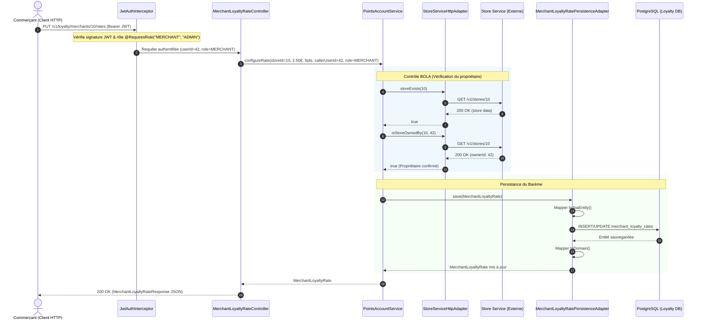

# Architecture Hexagonale (Ports et Adaptateurs) - ShopLoc Loyalty Service

Ce document détaille l'organisation, les principes directeurs et le fonctionnement concret de l'**Architecture Hexagonale** (ou architecture à *Ports et Adaptateurs*, initialement formalisée par Alistair Cockburn) mise en œuvre dans le microservice `ShopLoc-Loyalty-Service`.

---

## 1. Principes Fondamentaux

L'architecture hexagonale a pour objectif premier d'**isoler le cœur métier de l'application (Domaine)** de toute dépendance technologique ou infrastructurelle (frameworks, bases de données, protocoles de communication, bibliothèques tierces).

```mermaid
flowchart TB
    subgraph DrivingAdapters["Adaptateurs Primaires (Driving / Inbound)"]
        direction TB
        WebCtrl["REST Controller<br/>MerchantLoyaltyRateController"]
        KafkaConsumer["Futur Consommateur Kafka<br/>OrderPlacedEventListener"]
    end

    subgraph Core["Hexagone : Cœur Applicatif et Métier"]
        direction TB
        subgraph PortsIn["Ports Primaires (Inbound)"]
            InUseCase["ConfigureLoyaltyRateUseCase<br/>GetLoyaltyRateUseCase"]
        end

        subgraph Application["Orchestration Applicative"]
            AppService["PointsAccountService<br/>(Application Service)"]
        end

        subgraph Domain["Domaine Métier Pur (POJO)"]
            DomainModel["MerchantLoyaltyRate<br/>(Règles métier du barème)"]
            DomainExceptions["StoreAccessDeniedException<br/>StoreNotFoundException"]
        end

        subgraph PortsOut["Ports Secondaires (Outbound)"]
            PersistPort["MerchantLoyaltyRatePersistencePort"]
            StorePort["StoreVerificationPort"]
        end
    end

    subgraph DrivenAdapters["Adaptateurs Secondaires (Driven / Outbound)"]
        direction TB
        subgraph Persistence["Persistance PostgreSQL"]
            PersistAdapter["MerchantLoyaltyRatePersistenceAdapter"]
            SpringDataRepo["SpringDataRepository"]
            JpaEntity["MerchantLoyaltyRateJpaEntity"]
        end
        subgraph HttpClients["Clients HTTP Inter-Services"]
            StoreHttpAdapter["StoreServiceHttpAdapter<br/>(RestClient -> Store Service)"]
        end
    end

    WebCtrl -->|Invoque| InUseCase
    KafkaConsumer -.->|Invoquera| InUseCase
    InUseCase <|.. AppService
    AppService --> DomainModel
    AppService -->|Appelle| PersistPort
    AppService -->|Appelle| StorePort
    PersistAdapter ..|> PersistPort
    StoreHttpAdapter ..|> StorePort
    PersistAdapter --> SpringDataRepo
    PersistAdapter --> JpaEntity
```

### La Règle de Dépendance (Dependency Inversion Principle)
1. **Les couches extérieures dépendent des couches intérieures** : L'infrastructure connaît le domaine, mais le domaine **ne connaît jamais l'infrastructure**.
2. **Aucune annotation de framework dans `domain/`** : Le domaine ne contient aucun `@Entity`, `@Table`, `@RestController`, `@Autowired`, ni aucune référence à Spring, Hibernate, Jackson ou Jakarta.
3. **Inversion de contrôle via les Ports** : Le service applicatif communique avec l'extérieur uniquement au travers d'interfaces (les *Ports*). Les implémentations concrètes (les *Adaptateurs*) sont injectées à l'exécution par Spring.

---

## 2. Découpage Modulaire des Packages

Le code source sous `src/main/java/fr/miage/collectivit/loyaltyservice/` respecte scrupuleusement l'arborescence hexagonale :

```text
fr.miage.collectivit.loyaltyservice/
├── domain/                                      # 1. CŒUR MÉTIER PUR
│   ├── model/
│   │   └── MerchantLoyaltyRate.java             # Entité métier riche (calculs de conversion, validation)
│   ├── port/
│   │   ├── in/                                  # Ports primaires (cas d'utilisation exposés)
│   │   │   ├── ConfigureLoyaltyRateUseCase.java
│   │   │   └── GetLoyaltyRateUseCase.java
│   │   └── out/                                 # Ports secondaires (contrats requis par le domaine)
│   │       ├── MerchantLoyaltyRatePersistencePort.java
│   │       └── StoreVerificationPort.java
│   └── exception/                               # Exceptions métier pures
│       ├── StoreAccessDeniedException.java
│       └── StoreNotFoundException.java
│
├── application/                                 # 2. ORCHESTRATION APPLICATIVE
│   └── service/
│       └── PointsAccountService.java            # Service orchestrateur (prescrit par l'architecture ShopLoc)
│
├── infrastructure/                              # 3. ADAPTATEURS TECHNIQUES
│   └── adapter/
│       ├── in/
│       │   └── web/                             # Adaptateur primaire Web REST
│       │       ├── MerchantLoyaltyRateController.java
│       │       ├── GlobalExceptionHandler.java
│       │       └── dto/
│       │           ├── MerchantLoyaltyRateRequest.java
│       │           └── MerchantLoyaltyRateResponse.java
│       └── out/
│           ├── persistence/                     # Adaptateur secondaire Persistance JPA
│           │   ├── MerchantLoyaltyRatePersistenceAdapter.java
│           │   ├── entity/
│           │   │   └── MerchantLoyaltyRateJpaEntity.java
│           │   ├── mapper/
│           │   │   └── MerchantLoyaltyRateMapper.java
│           │   └── repository/
│           │       └── SpringDataMerchantLoyaltyRateRepository.java
│           └── rest/                            # Adaptateur secondaire Client HTTP
│               └── StoreServiceHttpAdapter.java
│
└── security/                                    # 4. SÉCURITÉ TRANSVERSALE
    ├── RequiresRole.java                        # Annotation déclarative RBAC
    ├── JwtAuthInterceptor.java                  # Intercepteur Spring MVC de validation JWT
    ├── JwtKeyProvider.java                      # Gestion des clés asymétriques RS256 et HMAC
    └── JwtValidatorService.java                 # Décodage, signature et liste de révocation
```

---

## 3. Rôle de Chaque Composant

### 3.1. Le Domaine Métier (`domain/`)
- **`MerchantLoyaltyRate`** : Modèle de domaine représentant le barème de fidélité d'un commerçant (`storeId`, `euroAmount`, `pointsReward`, `createdAt`, `updatedAt`).
  - Encapsule les règles d'intégrité : un barème est obligatoirement lié à un magasin, `euroAmount > 0` avec 2 décimales maximum, et `pointsReward >= 1`.
  - Fournit la méthode métier `calculatePoints(BigDecimal purchaseAmount)` pour déterminer instantanément les points gagnés pour un montant d'achat donné.
  - Fournit un barème par défaut standardisé : `MerchantLoyaltyRate.defaultForStore(storeId)` (1,00 € = 1 point).
- **`StoreAccessDeniedException` & `StoreNotFoundException`** : Exceptions métier indépendantes de tout code de statut HTTP.

### 3.2. Les Ports (`domain/port/`)
- **Ports Primaires (`port/in/`)** :
  - `ConfigureLoyaltyRateUseCase` : Méthode `configureRate(Long storeId, BigDecimal euroAmount, Integer pointsReward, Long callerUserId, String callerRole)`.
  - `GetLoyaltyRateUseCase` : Méthode `getRateByStoreId(Long storeId)`.
- **Ports Secondaires (`port/out/`)** :
  - `MerchantLoyaltyRatePersistencePort` : Contrat d'enregistrement et de lecture (`save`, `findByStoreId`, `existsByStoreId`, `deleteByStoreId`).
  - `StoreVerificationPort` : Contrat de vérification de l'existence d'un commerce et de l'appartenance au commerçant connecté (`isStoreOwnedBy(storeId, userId)`, `storeExists(storeId)`).

### 3.3. L'Application Service (`application/service/`)
- **`PointsAccountService`** :
  - Cœur applicatif prescrit par le modèle ArchiMate d'architecture d'entreprise (`Applicatif Shop Loc.archimate`).
  - Implémente `ConfigureLoyaltyRateUseCase` et `GetLoyaltyRateUseCase`.
  - Applique les contrôles d'accès et d'autorisation BOLA (*Broken Object Level Authorization*) :
    - Si l'appelant a le rôle `ADMIN`, la vérification de propriété est bypassée.
    - Si l'appelant est un `MERCHANT`, le service sollicite `StoreVerificationPort` pour vérifier qu'il est bien le propriétaire légitime du magasin avant d'autoriser la modification.
  - Invoque `MerchantLoyaltyRatePersistencePort` pour sauvegarder le barème.
  - *Extension future* : Ce service traitera également les événements Kafka de paiement de commande pour créditer les comptes points des clients.

### 3.4. Les Adaptateurs Secondaires (`infrastructure/adapter/out/`)
- **Adaptateur de Persistance (`adapter/out/persistence/`)** :
  - `MerchantLoyaltyRateJpaEntity` : Modèle relationnel mappé sur la table PostgreSQL `merchant_loyalty_rates` (avec timestamps automatiques `@PrePersist` / `@PreUpdate`).
  - `MerchantLoyaltyRateMapper` : Composant Spring qui isole le domaine de l'entité JPA en convertissant de manière bidirectionnelle (`toDomain` / `toJpaEntity`).
  - `MerchantLoyaltyRatePersistenceAdapter` : Implémente `MerchantLoyaltyRatePersistencePort` en déléguant au `SpringDataMerchantLoyaltyRateRepository`.
- **Adaptateur Client HTTP REST (`adapter/out/rest/`)** :
  - `StoreServiceHttpAdapter` : Implémente `StoreVerificationPort`.
  - Utilise le client moderne Spring `RestClient` pour interroger l'endpoint interne de Store Service : `GET /v1/stores/{storeId}`.
  - Traduit les réponses HTTP (404, 200 avec extraction de l'identifiant du propriétaire `ownerId`) en résultats booléens ou exceptions métier.

### 3.5. L'Adaptateur Primaire Web (`infrastructure/adapter/in/web/`)
- **`MerchantLoyaltyRateController`** :
  - Reçoit les requêtes HTTP JSON, valide les payloads d'entrée via Jakarta Bean Validation (`@Valid`, `@Positive`, `@Digits`).
  - Extrait l'identité de l'appelant (`authenticatedUserDbId`) et son rôle injectés dans la requête par l'intercepteur de sécurité.
  - Appelle les cas d'utilisation `GetLoyaltyRateUseCase` et `ConfigureLoyaltyRateUseCase`.
  - Transforme le modèle de domaine en DTO de sortie `MerchantLoyaltyRateResponse`.
- **`GlobalExceptionHandler`** :
  - Attrape les exceptions du domaine et les traduit en réponses JSON normalisées avec le statut HTTP approprié :
    - `StoreNotFoundException` -> HTTP 404 Not Found.
    - `StoreAccessDeniedException` -> HTTP 403 Forbidden.
    - `MethodArgumentNotValidException` / `IllegalArgumentException` -> HTTP 400 Bad Request.

---

## 4. Diagramme de Séquence : Configuration d'un Barème (PUT)

Ce diagramme illustre le cheminement complet d'une requête de configuration d'un barème de fidélité avec contrôle d'accès RBAC et protection BOLA :



---

## 5. Avantages Concrets de ce Modèle

1. **Testabilité Optimale et Rapide** :
   - Les règles métier de conversion (`MerchantLoyaltyRateTest`) s'exécutent en mémoire pure en moins de 50 ms sans charger Spring ni de conteneur de test.
   - Le service applicatif (`PointsAccountServiceTest`) se teste unitairement avec des mocks Mockito des seuls ports `StoreVerificationPort` et `MerchantLoyaltyRatePersistencePort`.
   - Les adaptateurs Web (`MerchantLoyaltyRateControllerIntegrationTest`) et HTTP (`StoreServiceHttpAdapterTest`) sont testés indépendamment.
2. **Indépendance vis-à-vis des Fournisseurs d'Infrastructure** :
   - Si la persistance doit migrer vers une base NoSQL ou si la vérification de magasin passe par un cache distribué Redis ou un bus Kafka, seul l'adaptateur secondaire concerné change ; le domaine et les contrôleurs restent strictement intacts.
3. **Sécurité dès la Conception (Security by Design)** :
   - L'isolation stricte des cas d'utilisation garantit qu'aucun commerçant ne peut modifier le barème d'un magasin tiers sans passer par la barrière de contrôle BOLA orchestrée dans le service applicatif.

