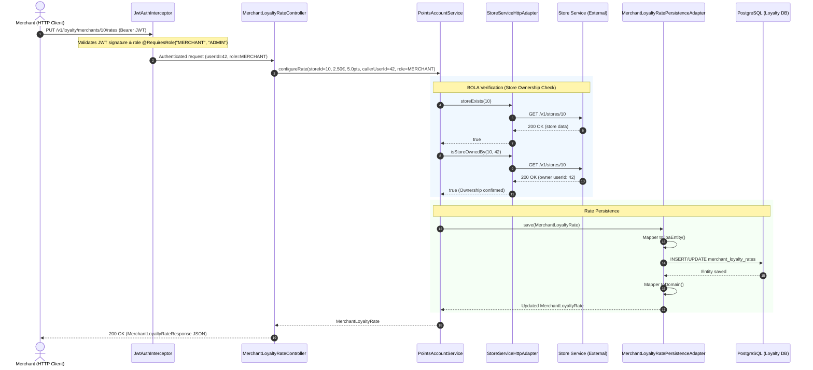

# Hexagonal Architecture (Ports and Adapters) - ShopLoc Loyalty Service

This document details the organization, guiding principles, and implementation of the **Hexagonal Architecture** (also known as the *Ports and Adapters* pattern, originally formulated by Alistair Cockburn) within the `ShopLoc-Loyalty-Service` microservice.

---

## 1. Core Principles

The primary objective of hexagonal architecture is to **isolate the core business logic (Domain)** from all technical and infrastructural concerns (frameworks, databases, communication protocols, third-party libraries).

```mermaid
flowchart TB
    subgraph DrivingAdapters["Primary Adapters (Driving / Inbound)"]
        direction TB
        WebCtrl["REST Controller<br/>MerchantLoyaltyRateController"]
        KafkaConsumer["Future Kafka Consumer<br/>OrderPlacedEventListener"]
    end

    subgraph Core["Hexagon: Core Application and Domain"]
        direction TB
        subgraph PortsIn["Primary Ports (Inbound)"]
            InUseCase["ConfigureMerchantLoyaltyRateUseCase<br/>GetMerchantLoyaltyRateQuery"]
        end

        subgraph Application["Application Orchestration"]
            AppService["PointsAccountService<br/>(Application Service)"]
        end

        subgraph Domain["Pure Business Domain (POJO)"]
            DomainModel["MerchantLoyaltyRate<br/>(Rate business rules)"]
            DomainExceptions["StoreAccessDeniedException<br/>StoreNotFoundException"]
        end

        subgraph PortsOut["Secondary Ports (Outbound)"]
            PersistPort["MerchantLoyaltyRatePersistencePort"]
            StorePort["StoreVerificationPort"]
        end
    end

    subgraph DrivenAdapters["Secondary Adapters (Driven / Outbound)"]
        direction TB
        subgraph Persistence["PostgreSQL Persistence"]
            PersistAdapter["MerchantLoyaltyRatePersistenceAdapter"]
            SpringDataRepo["SpringDataRepository"]
            JpaEntity["MerchantLoyaltyRateJpaEntity"]
        end
        subgraph HttpClients["Inter-Service HTTP Clients"]
            StoreHttpAdapter["StoreServiceHttpAdapter<br/>(RestClient -> Store Service)"]
        end
    end

    WebCtrl -->|Invokes| InUseCase
    KafkaConsumer -.->|Will invoke| InUseCase
    InUseCase <|.. AppService
    AppService --> DomainModel
    AppService -->|Calls| PersistPort
    AppService -->|Calls| StorePort
    PersistAdapter ..|> PersistPort
    StoreHttpAdapter ..|> StorePort
    PersistAdapter --> SpringDataRepo
    PersistAdapter --> JpaEntity
```

### The Dependency Inversion Principle
1. **Outer layers depend on inner layers**: Infrastructure knows about the domain, but the domain **never knows about the infrastructure**.
2. **Zero framework annotations in `domain/`**: The domain contains no `@Entity`, `@Table`, `@RestController`, `@Autowired`, nor any references to Spring, Hibernate, Jackson, or Jakarta.
3. **Inversion of control via Ports**: The application service interacts with the external world exclusively through interfaces (*Ports*). Concrete implementations (*Adapters*) are injected at runtime by Spring.

---

## 2. Package Structure

Source code under `src/main/java/fr/miage/collectivit/loyaltyservice/` strictly adheres to the hexagonal layout:

```text
fr.miage.collectivit.loyaltyservice/
├── domain/                                      # 1. PURE BUSINESS CORE
│   ├── model/
│   │   └── MerchantLoyaltyRate.java             # Rich domain entity (conversion calculations, validation)
│   ├── port/
│   │   ├── in/                                  # Primary ports (exposed use cases / queries)
│   │   │   ├── ConfigureMerchantLoyaltyRateUseCase.java
│   │   │   └── GetMerchantLoyaltyRateQuery.java
│   │   └── out/                                 # Secondary ports (contracts required by the domain)
│   │       ├── MerchantLoyaltyRatePersistencePort.java
│   │       └── StoreVerificationPort.java
│   └── exception/                               # Pure domain exceptions
│       ├── InvalidLoyaltyRateException.java
│       ├── MerchantLoyaltyRateNotFoundException.java
│       ├── StoreAccessDeniedException.java
│       └── StoreNotFoundException.java
│
├── application/                                 # 2. APPLICATION ORCHESTRATION
│   └── service/
│       └── PointsAccountService.java            # Orchestration service (prescribed by ShopLoc architecture)
│
├── infrastructure/                              # 3. TECHNICAL ADAPTERS
│   └── adapter/
│       ├── in/
│       │   └── web/                             # Primary Web REST adapter
│       │       ├── MerchantLoyaltyRateController.java
│       │       ├── GlobalExceptionHandler.java
│       │       └── dto/
│       │           ├── MerchantLoyaltyRateRequest.java
│       │           └── MerchantLoyaltyRateResponse.java
│       └── out/
│           ├── persistence/                     # Secondary JPA persistence adapter
│           │   ├── MerchantLoyaltyRatePersistenceAdapter.java
│           │   ├── entity/
│           │   │   └── MerchantLoyaltyRateJpaEntity.java
│           │   ├── mapper/
│           │   │   └── MerchantLoyaltyRateMapper.java
│           │   └── repository/
│           │       └── SpringDataMerchantLoyaltyRateRepository.java
│           └── rest/                            # Secondary HTTP REST client adapter
│               ├── StoreServiceHttpAdapter.java
│               └── dto/
│                   └── StoreDto.java
│
└── security/                                    # 4. CROSS-CUTTING SECURITY
    ├── RequiresRole.java                        # Declarative RBAC annotation
    ├── JwtAuthInterceptor.java                  # Spring MVC JWT validation interceptor
    ├── JwtKeyProvider.java                      # RS256 asymmetric and HMAC secret key provider
    ├── JwtValidatorService.java                 # Decoding, verification, and revocation check
    └── TokenRevocationService.java              # Blacklist / token revocation management
```

---

## 3. Role of Each Component

### 3.1. Business Domain (`domain/`)
- **`MerchantLoyaltyRate`**: Domain model representing a merchant's loyalty rate (`storeId`, `euroAmount`, `pointsReward`, `createdAt`, `updatedAt`).
  - Encapsulates integrity rules: a rate is strictly tied to a store, `euroAmount > 0` with up to 2 decimals, and `pointsReward >= 0.5` in steps of 0.5.
  - Provides the core business method `calculatePointsForPurchase(BigDecimal purchaseAmount)` to calculate points earned with 0.5 half-point precision and floor rounding.
  - Standard default rate factory: `MerchantLoyaltyRate.defaultForStore(storeId)` (1.00 € = 1.0 pt).
- **Domain Exceptions**: Pure exceptions independent of HTTP status codes (`StoreNotFoundException`, `StoreAccessDeniedException`, `InvalidLoyaltyRateException`, `MerchantLoyaltyRateNotFoundException`).

### 3.2. Ports (`domain/port/`)
- **Primary Ports (`port/in/`)**:
  - `ConfigureMerchantLoyaltyRateUseCase`: Method `configureRate(Long storeId, BigDecimal euroAmount, BigDecimal pointsReward, Long callerUserId, String callerRole)`.
  - `GetMerchantLoyaltyRateQuery`: Method `getRateByStoreId(Long storeId)`.
- **Secondary Ports (`port/out/`)**:
  - `MerchantLoyaltyRatePersistencePort`: Persistence contract (`save`, `findByStoreId`, `existsByStoreId`, `deleteByStoreId`).
  - `StoreVerificationPort`: Verification contract to validate store existence and merchant ownership (`isStoreOwnedBy(storeId, userId)`, `storeExists(storeId)`).

### 3.3. Application Service (`application/service/`)
- **`PointsAccountService`**:
  - Application core prescribed by enterprise architecture models.
  - Implements `ConfigureMerchantLoyaltyRateUseCase` and `GetMerchantLoyaltyRateQuery`.
  - Enforces BOLA (*Broken Object Level Authorization*) controls:
    - If caller has the `ADMIN` role, ownership verification is bypassed.
    - If caller is a `MERCHANT`, the service queries `StoreVerificationPort` to confirm legitimate store ownership before allowing updates.
  - Calls `MerchantLoyaltyRatePersistencePort` to persist changes.
  - *Future extension*: Will process Kafka order-placed events to credit customer point accounts.

### 3.4. Secondary Adapters (`infrastructure/adapter/out/`)
- **Persistence Adapter (`adapter/out/persistence/`)**:
  - `MerchantLoyaltyRateJpaEntity`: Relational model mapped to the PostgreSQL `merchant_loyalty_rates` table.
  - `MerchantLoyaltyRateMapper`: Spring component isolating the domain from the JPA entity with bidirectional conversion (`toDomain` / `toJpaEntity`).
  - `MerchantLoyaltyRatePersistenceAdapter`: Implements `MerchantLoyaltyRatePersistencePort` delegating to `SpringDataMerchantLoyaltyRateRepository`.
- **HTTP REST Adapter (`adapter/out/rest/`)**:
  - `StoreServiceHttpAdapter`: Implements `StoreVerificationPort`.
  - Uses Spring `RestClient` to query Store Service: `GET /v1/stores/{storeId}`.
  - Converts HTTP responses (404, 200 with owner ID) into boolean checks or domain exceptions.

### 3.5. Primary Web Adapter (`infrastructure/adapter/in/web/`)
- **`MerchantLoyaltyRateController`**:
  - Handles incoming JSON HTTP requests, validates payloads using Jakarta Bean Validation (`@Valid`, `@Positive`, `@Digits`).
  - Extracts caller identity (`authenticatedUserDbId`) and role injected by security interceptor.
  - Invokes `GetMerchantLoyaltyRateQuery` and `ConfigureMerchantLoyaltyRateUseCase`.
  - Maps domain model to `MerchantLoyaltyRateResponse` DTO.
- **`GlobalExceptionHandler`**:
  - Catches domain and validation exceptions, mapping them to standard JSON error responses with appropriate HTTP statuses:
    - `StoreNotFoundException`, `MerchantLoyaltyRateNotFoundException` -> HTTP 404 Not Found.
    - `StoreAccessDeniedException` -> HTTP 403 Forbidden.
    - `InvalidLoyaltyRateException`, `MethodArgumentNotValidException`, `HandlerMethodValidationException` -> HTTP 400 Bad Request.

---

## 4. Sequence Diagram: Configuring a Rate (PUT)

The following diagram illustrates the complete flow for updating a loyalty rate with RBAC security and BOLA protection:



---

## 5. Architectural Benefits

1. **Fast, Isolated Testing**:
   - Domain business rules (`MerchantLoyaltyRateTest`) execute purely in-memory in under 50 ms without loading Spring or external containers.
   - Application service (`PointsAccountServiceTest`) is tested in isolation with Mockito mocks for `StoreVerificationPort` and `MerchantLoyaltyRatePersistencePort`.
   - Web adapters (`MerchantLoyaltyRateControllerIntegrationTest`) and REST adapter (`StoreServiceHttpAdapterTest`) are verified with targeted integration tests.
2. **Infrastructure Independence**:
   - Swapping persistence to another store or using Redis/Kafka for store verification only requires changing secondary adapters; domain models and controllers remain completely untouched.
3. **Security by Design**:
   - Strict use-case orchestration guarantees that no merchant can modify a competitor's rate without passing through BOLA checks in the application service.
